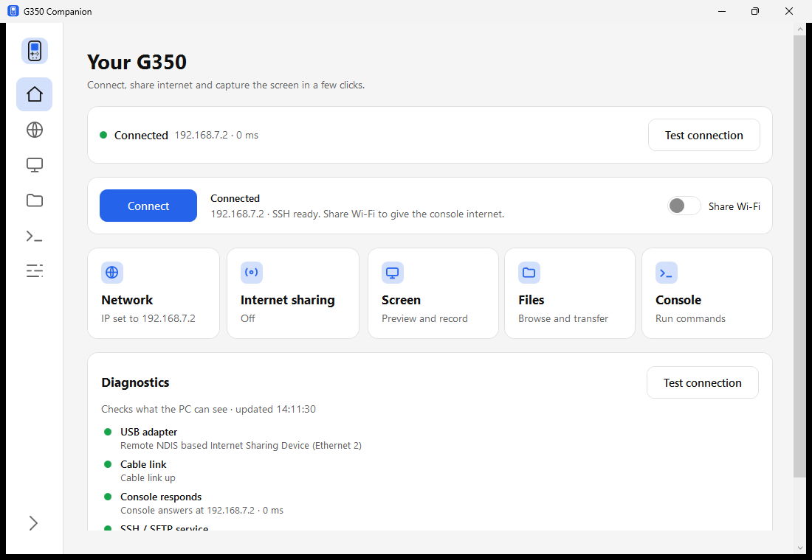
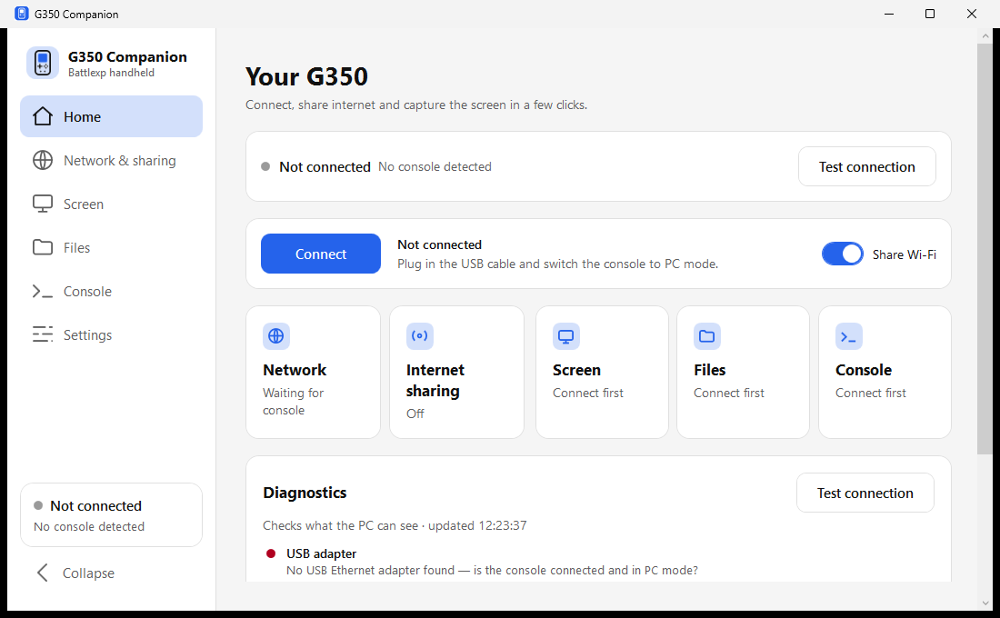
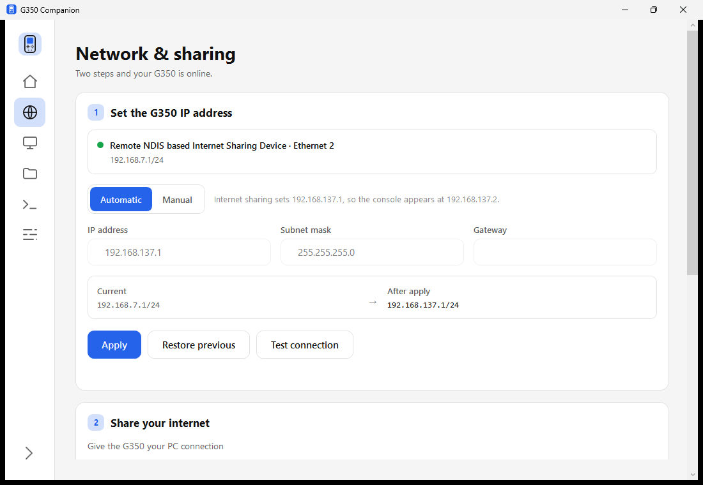
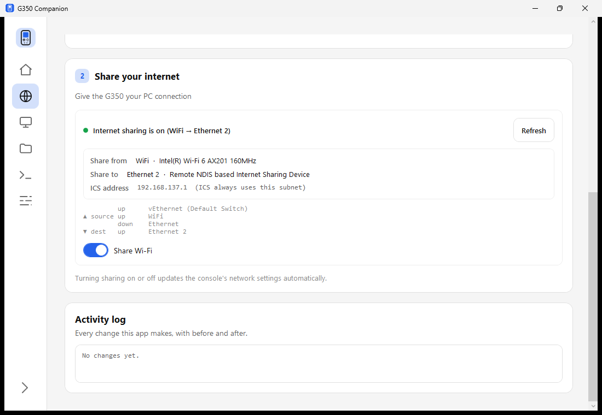
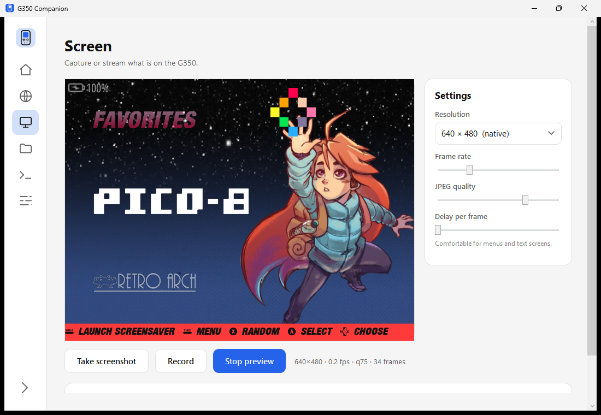
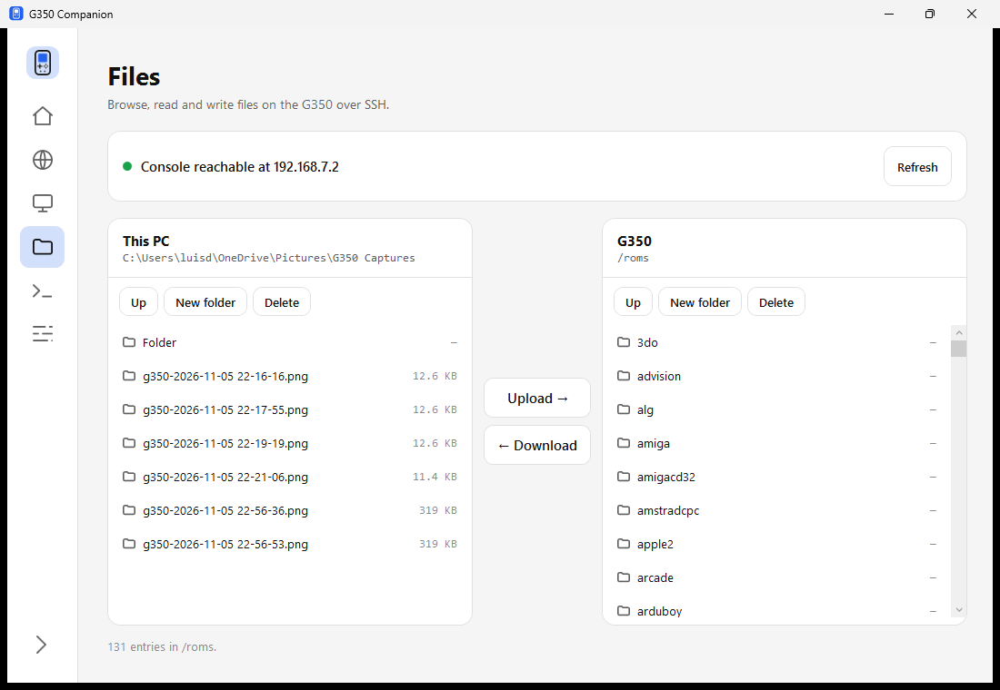
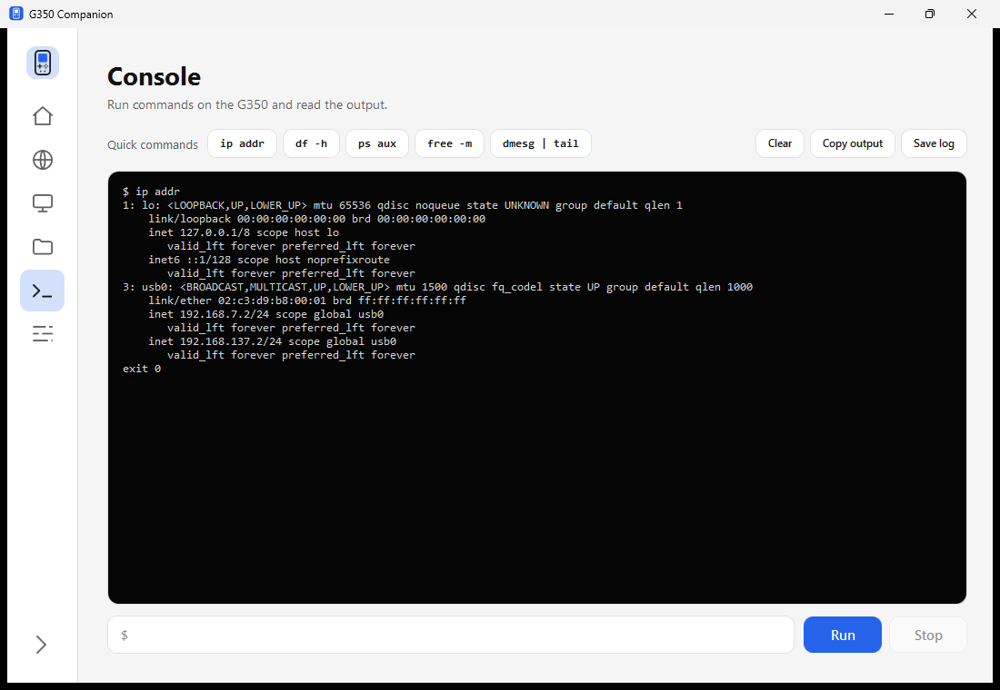
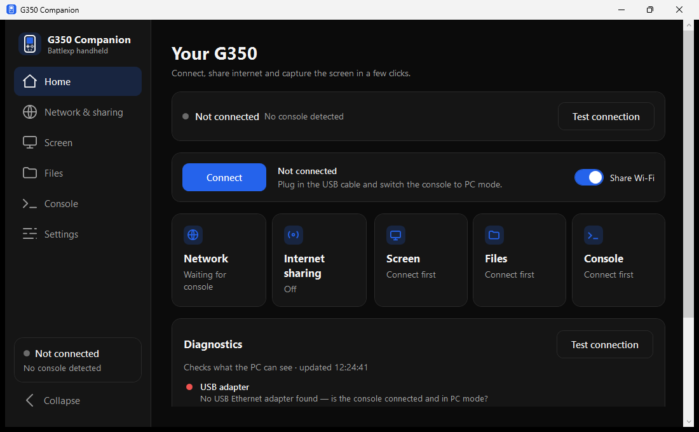

# G350 Companion: complete guide

> **Target:** a Battle XP G350 or compatible Rockchip RK3326 handheld running
> ArkOS / dArkOS, connected to a Windows 10 or 11 PC.
> **Scope:** this guide uses the **G350 Companion** Windows app. The app does the
> Windows configuration for you, and adds screen preview, recording, a file
> browser and a remote console.

---

## 1. What the app does

Without help, getting a G350 onto your PC means a fixed routine: open
`ncpa.cpl`, find the right adapter among several, type a static address, then
right-click the Wi-Fi adapter and turn on sharing. Every time you want to move a
file you reach for a separate SFTP client, and to look at the console's screen
you unplug the cable and pick the device up.

G350 Companion replaces all of that with one window. It configures the adapter,
controls internet sharing, previews and records the console's screen, browses its
files, and runs commands on it — over the same USB cable.

The app is the **PC side**. The console still needs the companion script,
[USB Network Manager](https://github.com/Just-Luis/BatleXP-G350_USBNetworkManager),
installed first. If you have not done that yet, complete
[its guide](https://github.com/Just-Luis/BatleXP-G350_USBNetworkManager/blob/main/COMMUNITY_TUTORIAL.md),
then come back here.

### Which guide do I want?

| You want to… | Use |
| :--- | :--- |
| Configure Windows by hand, with no extra software | The [standalone guide](https://github.com/Just-Luis/BatleXP-G350_USBNetworkManager/blob/main/COMMUNITY_TUTORIAL.md) |
| Have the app handle Windows, and add screen and file tools | This guide |

---

## 2. Before you start

| You need | Detail |
| :--- | :--- |
| Console | Battle XP G350 running ArkOS / dArkOS |
| Cable | **USB-A to USB-C data cable** — USB-A into the PC, USB-C into the console |
| PC | Windows 10 or 11, x64, with Wi-Fi or Ethernet for internet sharing |
| Console script | `USB_Network_Manager.sh`, installed in `tools/` or `ports/` |
| ffmpeg *(optional)* | Only needed for recording. `winget install ffmpeg` or `choco install ffmpeg` |

> [!CAUTION]
> **Do not use a USB-C to USB-C cable.** Budget handhelds lack the dual 5.1 kΩ CC
> pull-down resistors on their USB-C port, so a C-to-C link will not enumerate.
> Use **USB-A (PC) to USB-C (handheld)**.

---

## 3. Install the app

### Option A — portable executable

Download `G350ConnectionManager.exe` from the
[Releases](https://github.com/Just-Luis/G350ConnectionManager/releases) page and
run it. There is no installer and no .NET runtime to install; the download is
self-contained.

### Option B — build from source

Requires the [.NET 8 SDK](https://dotnet.microsoft.com/download/dotnet/8.0).

```powershell
git clone https://github.com/Just-Luis/G350ConnectionManager.git
cd G350ConnectionManager
dotnet publish src/G350ConnectionManager/G350ConnectionManager.csproj -c Release -o out
```

The executable lands in `out\G350ConnectionManager.exe`.

> [!NOTE]
> Windows may show a SmartScreen warning for an unsigned executable. Choose
> **More info → Run anyway**, or build from source.

---

## 4. First run: two buttons

Everything you need per session is on the **Home** page.


*Figure 1: The Home page. Connect on the left, Share Wi-Fi on the right.*

### Step 1 — Start the console's services

On the handheld, open **TOOLS** (or **PORTS**) and launch **USB Network Manager**.
Check that **`USB MODE`** reads **`WIRED PC (Peripheral)`** — if it reads
**`USB HOST`**, press **[X]** and let the console reboot.

Press **[A] Start Services**. This loads the USB gadget and starts SSH, which is
what makes the console reachable. Nothing on the PC can do this for you.

### Step 2 — Connect the cable

Connect the **USB-A** end to the PC and the **USB-C** end to the console's
**OTG / DC** port. Windows plays its device chime once the gadget is up.

### Step 3 — Press Connect

Press **Connect**. The app runs a full probe and reports what it found.

The status banner and the Connect row both turn green, and the address the
console answers on is shown next to them. The five cards below — Network,
Internet sharing, Screen, Files, Console — become live.

If the probe fails, the Diagnostics panel names the step that failed rather than
only saying something is wrong. See [Troubleshooting](#11-troubleshooting).

### Step 4 — Turn on Share Wi-Fi (optional)

To give the console internet access, turn on **Share Wi-Fi**. Windows asks for
elevation the first time; this is expected, because internet sharing is a
system-wide setting.

The app then:

1. Enables Windows Internet Connection Sharing with Wi-Fi as the source.
2. Ensures the console adapter is on `192.168.137.1`.
3. Tells the console to re-apply its networking.
4. Verifies the console actually reached the internet.

The console moves to `192.168.137.2`, and the switch stays on only if all four
steps succeeded. If Windows refuses, the switch snaps back rather than claiming a
state that was not applied.

> [!IMPORTANT]
> **You are now fully set up.** Everything below is optional; each section
> explains one page.

---

## 5. Home page


*Figure 2: The Home page in the light theme.*

| Element | What it shows |
| :--- | :--- |
| **Status banner** | One line stating whether the console is reachable, and its address. **Test connection** re-runs the probe |
| **Connect** | Runs the full probe: adapter, cable link, console response and SSH port |
| **Share Wi-Fi** | Internet sharing for the console, on or off |
| **Five cards** | A one-line summary each: Network, Internet sharing, Screen, Files, Console. Click an icon to open that page |
| **Diagnostics** | Every probe result with its detail line, so a failure names the cause |

The Diagnostics panel distinguishes states that look identical without it:

* The adapter is missing — check the cable, the USB mode and whether the adapter
  is disabled in Windows.
* The adapter is up but the console does not answer — services are not running on
  the console.
* The console answers but SSH is closed — the console's own services are stopped.
* All of the above pass but there is no internet — sharing is off or has failed.

---

## 6. Network & sharing page

This page exposes the individual steps that **Share Wi-Fi** performs, for when
you want to see or control them directly.


*Figure 3: The address section, showing current and pending state side by side.*

### Step 1 — Set the G350 IP address

| Control | Purpose |
| :--- | :--- |
| **Automatic** | Follows the sharing state. Addresses the adapter with `192.168.137.1` when sharing is on, `192.168.7.1` when it is off |
| **Manual** | Lets you type the address, mask and gateway |
| **Current → After apply** | Shows the existing configuration beside the one that will be applied, before you commit |
| **Apply** | Writes the change and re-applies the console's networking |
| **Restore previous** | Returns the adapter to the configuration captured before the last Apply |
| **Test connection** | Re-runs the probe without changing anything |

Use **Manual** if the console is configured for a different subnet, or if the
adapter is already correct and you only need to confirm it. **Restore previous**
is the safe way out of a change that did not help.

### Step 2 — Share your internet


*Figure 4: Sharing on, with the source and destination adapters named.*

| Row | Meaning |
| :--- | :--- |
| **Internet sharing is on/off** | The current state as Windows reports it |
| **Share from** | The adapter that provides the connection. The app picks it by driver description, not by name |
| **Share to** | The console adapter that receives it |
| **ICS address** | The address ICS assigns; always in the `192.168.137.x` range |
| **Adapter list** | Every connection, whether it is up, and which side of the sharing it is on |
| **Share Wi-Fi** | The same switch as the Home page. Moving it here moves it there |

The **Activity log** at the bottom of the page records every system change with
its before and after value, which is the first thing to check when something did
not do what you expected.

> [!NOTE]
> **Turning sharing off does not break the link.** ICS removes its address from
> the adapter when sharing stops. The app returns the adapter to `192.168.7.1`
> afterwards, but only when the adapter has no usable address of its own, so a
> configuration you chose is never overwritten.

---

## 7. Screen page

Preview, screenshot and record the console's screen without touching the device.


*Figure 5: A live preview with the frame counter and current quality settings.*

### Controls

| Button | Action |
| :--- | :--- |
| **Start preview / Stop preview** | Opens or closes the live stream |
| **Take screenshot** | Saves a PNG of the current frame |
| **Record / Stop** | Records to an MP4 using ffmpeg on the PC |

### Quality settings

| Setting | Effect |
| :--- | :--- |
| **Resolution** | `320 × 240` is fastest, `640 × 480` is native. The console's panel is 640 × 480 |
| **Frame rate** | How many frames per second the app requests |
| **JPEG quality** | Lower values compress more and transfer faster, at the cost of sharpness |
| **Delay per frame** | Adds a pause between frames, which helps on a busy console |

Changes apply while the preview is running; there is no need to restart it. The
status line under the preview shows the measured `width × height · fps · quality ·
frame count`, so you can see what the settings actually produced.

> [!TIP]
> **Recording needs ffmpeg on the PC**, not on the console. Install it with
> `winget install ffmpeg` and make sure it is on `PATH`. If it is missing, the
> app says so plainly instead of writing a broken file.
>
> The frame rate and resolution are fixed for the length of a recording, because
> an encoder cannot change dimensions mid-file. Set them before you press
> **Record**.

Screenshots and recordings are saved to the folders chosen on the Settings page.
Recent screenshots are listed under the preview and open in your default image
viewer when clicked.

---

## 8. Files page

A two-pane file browser: your PC on the left, the console on the right. No
external SFTP client needed.


*Figure 6: The console pane showing its ROM folders.*

| Control | Action |
| :--- | :--- |
| **Up** | Move to the parent folder |
| **New folder** | Create a folder in the current pane |
| **Delete** | Delete the selected entry |
| **Upload →** | Copy the selected local file to the console pane's folder |
| **← Download** | Copy the selected console file to the local pane's folder |
| **Refresh** | Re-read the console's folder |

Double-click a folder to open it. The console pane opens at `/roms`, where the
game folders live (`gba`, `snes`, `psx`, …). Drag a ROM into the matching folder,
or download a save file to your PC.

> [!NOTE]
> Each operation opens its own SSH session. A long-lived connection would be
> faster, but it breaks whenever the console's address changes, which happens
> every time sharing is toggled.

---

## 9. Console page

Run commands on the console over SSH and read the output.


*Figure 7: `ip addr` showing the console's interface and both of its addresses.*

| Control | Action |
| :--- | :--- |
| **Quick commands** | One click each for `ip addr`, `df -h`, `ps aux`, `free -m`, `dmesg \| tail` |
| **Run** | Runs whatever is in the input box |
| **Stop** | Cancels a running command |
| **Clear** | Empties the output |
| **Copy output** | Copies everything shown to the clipboard |
| **Save log** | Writes the output to a file |

Each command gets its own session, so a command that hangs cannot block the next
one, and **Stop** ends the remote process rather than only the display.

Useful things to check:

```bash
ip addr          # is usb0 up, and which addresses does it hold?
df -h            # is the SD card full?
ps aux           # are sshd and smbd running?
dmesg | tail     # did the USB gadget load cleanly?
```

---

## 10. Settings page


*Figure 8: The Home page in the dark theme. Theming applies everywhere.*

| Setting | Effect |
| :--- | :--- |
| **Theme** | White or Black, applied immediately across the whole app |
| **Highlight color** | Six accents. Used for buttons, switches and status; backgrounds stay white or black |
| **Start with sidebar collapsed** | Starts with the icon-only sidebar |
| **Save captures to** | Separate folders for screenshots and recordings. Both default to `Pictures\G350 Captures` |
| **Console account** | The SSH and SFTP username and password. Leave blank for the ArkOS default of `ark` / `ark` |

Everything on this page is saved to
`%APPDATA%\G350ConnectionManager\settings.json` and restored on the next launch.

> [!TIP]
> **Changed the console's password?** Enter it under **Console account** and every
> feature that reaches the console will use it. There is no need to reinstall or
> reconfigure anything else.

---

## 11. Troubleshooting

### Connect says "no USB Ethernet adapter found"

1. Check **`USB MODE`** on the console reads **`WIRED PC (Peripheral)`**. Press
   **[X]** if not, and let the console reboot.
2. Press **[A]** on the console. The gadget is not loaded until services start.
3. Try a different USB port on the PC.
4. The adapter may be disabled in Windows. A disabled adapter is invisible to
   many tools; check `Get-NetAdapter` in PowerShell for an entry marked
   `Disabled`, and enable it.

The app reports a disabled adapter specifically rather than claiming none exists.

### Connect says the console is reachable but SSH is closed

The link works; the console's own services are stopped. Press **[A]** on the
console, or turn on **Share Wi-Fi**, which starts them.

### Share Wi-Fi snaps back to off

Windows refused the change. Open the **Activity log** on the Network & sharing
page for the before and after values, then turn sharing on by hand in `ncpa.cpl`
to see the Windows error. An elevation prompt that was declined also causes this.

### The console has no internet but the app says sharing is on

Check whether the console shows a gateway. Sharing can report success while the
adapter holds an address outside both project ranges. Press **Apply** on the
Network page to place it on `192.168.137.1`, then re-run **Test connection**.

### Recording says ffmpeg was not found

Install ffmpeg on the PC and make sure it is on `PATH`:

```powershell
winget install ffmpeg
```

Then reopen the app so it picks up the new `PATH`.

### Files page says the console is not reachable

Everything else uses the same SSH connection, so if the Files page fails, press
**Connect** on Home first. If Connect also fails, work through the first item.

### The preview is black

The console's screen may have gone to sleep. Press a button on the handheld and
the preview recovers.

---

## 12. Concepts worth knowing

### Two address ranges, and why

| State | PC adapter | Console | Gateway |
| :--- | :--- | :--- | :--- |
| Sharing off | `192.168.7.1/24` | `192.168.7.2` | `192.168.7.1` |
| Sharing on (Windows ICS) | `192.168.137.1/24` | `192.168.137.2` | `192.168.137.1` |

These are protocol constants, not preferences. Windows ICS always assigns
`192.168.137.1` to the shared adapter, while the manual setup documented by the
console project uses `192.168.7.x`. The console carries both addresses and routes
through whichever gateway answers, so SSH and SFTP keep working whichever state
the PC is in.

### Why elevation appears sometimes

Reading ICS status does not need it. Changing sharing does, because it is a
system-wide setting. The app re-launches itself elevated for that single
operation and nothing else, so a status poll never raises a prompt.

### Why the console must start its own services

Only the console can load its USB gadget and start SSH. The app can ask it to
re-apply networking once those services exist, which is what happens automatically
after a sharing change, but the first start is always the **[A]** button.

---

## 13. Related

- **[USB Network Manager](https://github.com/Just-Luis/BatleXP-G350_USBNetworkManager)**
  — the console-side script, and its standalone Windows guide.
- **[RK3326-USB-Netplay](https://github.com/Just-Luis/RK3326-USB-Netplay)** —
  console-to-console wired netplay for the same hardware.

---

## 14. License

MIT. See [LICENSE](LICENSE).

Thanks to the [ArkOS](https://github.com/christianhaitian/arkos) project and the
PortMaster community.
