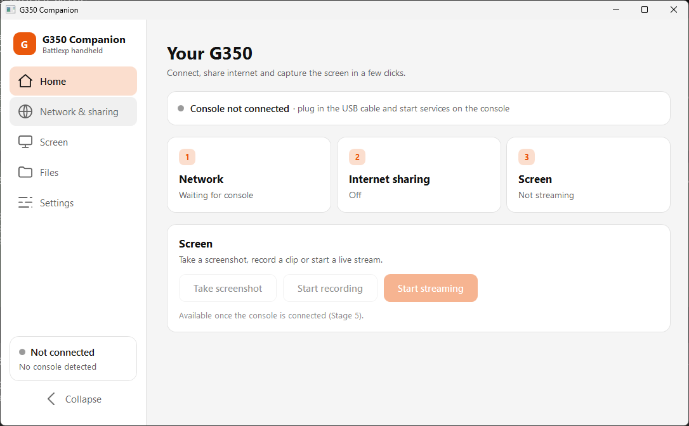
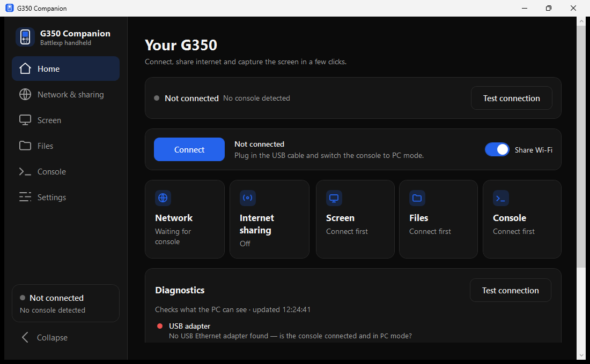
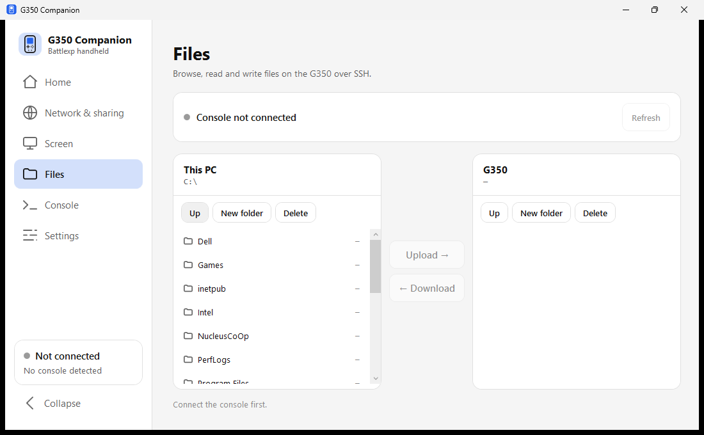
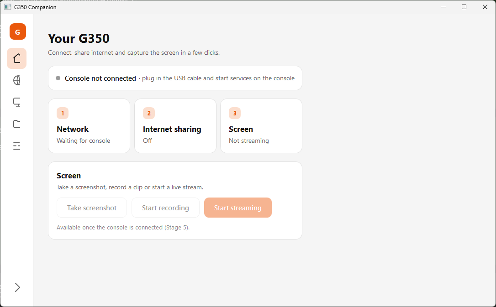

# 🎮 G350 Companion — Windows Connection Manager

> **A single portable `.exe` that connects your Battle XP G350 (Rockchip RK3326) to your PC over USB:**
> network setup, internet sharing, screenshot, recording, screen streaming and file transfer —
> all from one gamepad-free Windows app.

[]()
[]()
[]()
[](LICENSE)

---

> [!NOTE]
> **Work in progress.** This repository is being built up in nine independently testable
> stages. Stages 1–3 (UI shell, live diagnostics, adapter IP configuration) are complete and runnable.
> See **[docs/PLAN.md](docs/PLAN.md)** for the full roadmap.

---

## 📸 Look & Feel

| Light | Dark |
| :---: | :---: |
|  |  |

| Files (dual pane) | Collapsed sidebar |
| :---: | :---: |
|  |  |

Six highlight colours, a collapsible icon-only sidebar, and a UI that mirrors the
original design mock.

---

## 🗺️ Roadmap

| Stage | Feature | Status |
| :--- | :--- | :--- |
| **1** | Shell & design system (navigation, themes, accent colours, settings persistence) | ✅ **Done** |
| **2** | Read-only diagnostics (adapter detection, ping, SSH port, live status) | ✅ **Done** |
| **3** | Adapter IP configuration (automatic & manual, with restore) | ✅ **Done** · 83/83 hardware tests passed |
| 4a | Internet sharing — read-only status (adapter list, conflict warnings) | ✅ **Done** |
| 4b | Internet sharing — enable/disable toggle | ⬜ Planned |
| 5 | Screen preview & screenshots | ⬜ Planned |
| 6 | MJPEG streaming | ⬜ Planned |
| 7 | Recording (MJPEG `.avi`) | ⬜ Planned |
| 8 | Files (SFTP dual pane) | ⬜ Planned |
| 9 | Polish & packaging (hotkeys, CI, signed release) | ⬜ Planned |
| *10* | *Optional: H.264/MP4 via bundled FFmpeg* | ⬜ Later |

Each stage ships its own tag and release, so any point can be rolled back to.

---

## 🚀 Running It

### Option A — download the portable EXE
Grab `G350ConnectionManager.exe` from the [Releases](../../releases) page and run it.
**No installer, no .NET runtime required** — the build is self-contained.

### Option B — build from source
Requires the [.NET 8 SDK](https://dotnet.microsoft.com/download/dotnet/8.0).

```powershell
git clone https://github.com/Just-Luis/G350ConnectionManager.git
cd G350ConnectionManager\src\G350ConnectionManager

# quick debug run
dotnet run

# portable single-file release  ->  bin\Release\net8.0-windows\win-x64\publish\
dotnet publish -c Release
```

---

## 🧩 What It Will Do

| Today (manual) | With G350 Companion |
| :--- | :--- |
| Open `ncpa.cpl`, find the adapter, set `192.168.7.1` by hand | Detected and configured for you |
| Right-click Wi‑Fi → Sharing → pick adapter → OK | One toggle |
| Run `Test_Connection_G350.bat` to see if it worked | Live status in the UI |
| `pip install paramiko pillow` then `python Stream_Screen.py` | Built in |
| Screenshots via a Tk window | Dedicated capture / record / stream |
| Drag files through WinSCP | Built-in dual-pane SFTP browser |

---

## 🎨 Design System

Tokens were extracted from the original design mock and live in `src/G350ConnectionManager/Themes/`.

| | Light | Dark |
| :--- | :--- | :--- |
| App background | `#F5F5F5` | `#0B0B0B` |
| Surface / sidebar | `#FFFFFF` | `#151515` |
| Border | `#E0E0E0` | `#2A2A2A` |
| Text primary | `#111111` | `#F5F5F5` |
| Text secondary | `#5F5F5F` | `#A3A3A3` |

Accent defaults to `#2563EB`; `soft` is the accent at 20 % alpha, and `onAccent` switches
between `#111111` and `#FFFFFF` by luminance — the same rule the mock uses.

Component metrics: nav button `46 px / r10`, primary button `44 px / r10`, segmented
control `38 px / r8`, input `42 px / r10`, card `r14`.

---

## 📁 Repository Layout

```
G350ConnectionManager/
├── docs/
│   ├── PLAN.md              full plan, decisions and staged roadmap
│   ├── BATTERY_TEST_v0.3.0.md  manual test checklist
│   └── screenshots/         UI progress shots
├── src/G350ConnectionManager/
│   ├── App.xaml(.cs)        startup, settings load, theme init
│   ├── MainWindow.xaml(.cs) sidebar shell + navigation
│   ├── Models/              AppSettings (JSON persistence)
│   ├── Services/            ThemeService (themes + accent derivation)
│   ├── Themes/              Light.xaml, Dark.xaml, Controls.xaml, Icons.xaml
│   └── Views/               Home, Network, Screen, Files, Settings
└── .github/workflows/       build + release automation
```

---

## 🔗 Companion Projects

* 🖥️ **USB Network Manager (console side):** [BatleXP-G350_USBNetworkManager](https://github.com/Just-Luis/BatleXP-G350_USBNetworkManager)
* 🕹️ **2-Player Wired Netplay:** [RK3326-USB-Netplay](https://github.com/Just-Luis/RK3326-USB-Netplay)

> [!IMPORTANT]
> This app is the **PC side**. The console still needs **`USB_Network_Manager.sh`**
> run once with **[A] Start Services** so the USB network gadget comes up.

---

## 📜 License

Licensed under the [MIT License](LICENSE).
