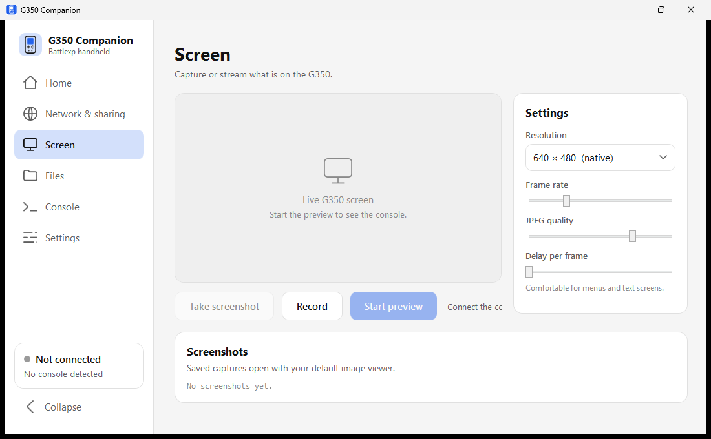
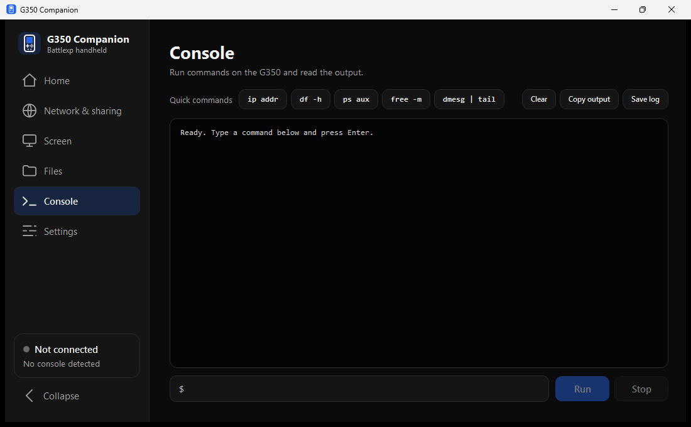

# G350 Companion

A Windows app that connects a Battle XP G350 (Rockchip RK3326) handheld to a PC
over a single USB cable, then manages the link, internet sharing, screen capture
and file transfer from one window.

[]()
[]()
[](LICENSE)

---

## Who this is for

Owners of a Battle XP G350 or a comparable ArkOS / dArkOS handheld who want to
reach the device from Windows without editing network settings by hand. It
replaces the manual procedure — open `ncpa.cpl`, locate the RNDIS adapter, assign
a static address, right-click the Wi-Fi adapter and enable sharing — with a
Connect button and a Share Wi-Fi switch.

The app is the PC side. The console side is
[USB Network Manager](https://github.com/Just-Luis/BatleXP-G350_USBNetworkManager),
which must be installed on the handheld first.

---

## Screenshots

| Home (light) | Home (dark) |
| :---: | :---: |
|  |  |

| Screen | Files |
| :---: | :---: |
|  |  |

| Console (dark) |
| :---: |
|  |

Two themes, six highlight colours, and a sidebar that collapses to icons.

---

## First run

1. On the console, launch **USB Network Manager** and press **[A] Start Services**.
   This brings up the USB network gadget.
2. Connect a **USB-A to USB-C** cable between the PC and the console's OTG port.
3. Open G350 Companion and press **Connect** on the Home page.
4. Optionally turn on **Share Wi-Fi** to give the console internet access
   through the PC.

Both actions live on the Home page and no other tab is needed to get online.
Everything else — the Network & sharing detail view, Screen, Files and Console —
becomes available once the console is reachable.

> [!NOTE]
> **Share Wi-Fi** changes Windows Internet Connection Sharing, so Windows will
> ask for elevation the first time. The prompt is expected.

For a walkthrough of every page, see **[COMPANION_TUTORIAL.md](COMPANION_TUTORIAL.md)**.

---

## Install

### Option A — portable executable

Download `G350ConnectionManager.exe` from the
[Releases](../../releases) page and run it. No installer and no .NET runtime is
required; the build is self-contained.

### Option B — build from source

Requires the [.NET 8 SDK](https://dotnet.microsoft.com/download/dotnet/8.0).

```powershell
git clone https://github.com/Just-Luis/G350ConnectionManager.git
cd G350ConnectionManager

# run from source
dotnet run --project src/G350ConnectionManager

# portable single file -> out/G350ConnectionManager.exe
dotnet publish src/G350ConnectionManager/G350ConnectionManager.csproj -c Release -o out
```

The application stores its preferences in
`%APPDATA%\G350ConnectionManager\settings.json`. Captures default to
`%USERPROFILE%\Pictures\G350 Captures` and can be redirected on the Settings page.

---

## Features

| Area | What it does |
| :--- | :--- |
| **Connect** | Probes the USB adapter, cable link, console reachability and SSH port, and reports which step failed rather than only that something did |
| **Share Wi-Fi** | Enables or disables Windows internet sharing for the console, then verifies the console actually reached the internet. A refused change snaps the switch back |
| **Network & sharing** | Chooses the adapter address and shows adapter, ICS and forwarding state with the exact command output |
| **Screen** | Live preview of the console screen, screenshots, and H.264 MP4 recording, with resolution, frame rate, JPEG quality and frame-delay controls |
| **Files** | Dual-pane SFTP browser that moves files between the PC and the console without an external client |
| **Console** | Runs commands on the console over SSH and shows the output, with a few common commands one click away |
| **Diagnostics** | Read-only report of what the PC can see: adapter, link, ping, SSH, internet |

### Network scheme

Two address ranges are used, and they are protocol constants rather than local
settings:

| State | PC adapter | Console | Gateway |
| :--- | :--- | :--- | :--- |
| Sharing off (direct) | `192.168.7.1/24` | `192.168.7.2` | `192.168.7.1` |
| Sharing on (Windows ICS) | `192.168.137.1/24` | `192.168.137.2` | `192.168.137.1` |

Windows Internet Connection Sharing always assigns `192.168.137.1` to the shared
adapter, while the direct setup documented by the console-side project uses
`192.168.7.x`. The console carries both addresses and picks the route that
answers, so SSH and SFTP keep working whichever state the PC is in.

Turning sharing off makes ICS remove its address from the adapter. The app
returns the adapter to `192.168.7.1` afterwards, but only when the adapter has no
usable address of its own, so a configuration chosen by the user is never
overwritten.

The console's SSH and SFTP account defaults to the ArkOS pair, user `ark` and
password `ark`, on port `22`. If the console's password has been changed, enter
the new credentials on the **Settings** page under **Console account**; every
feature that reaches the console then uses them.

---

## Requirements

- Windows 10 or 11, x64
- A Battle XP G350 or comparable RK3326 handheld running ArkOS / dArkOS
- A USB-A to USB-C data cable

> [!WARNING]
> Use a **USB-A to USB-C** cable. Budget handhelds lack the CC pull-down
> resistors needed for USB-C to USB-C links, which will not enumerate.

---

## Related projects

- **[USB Network Manager](https://github.com/Just-Luis/BatleXP-G350_USBNetworkManager)** —
  the console-side script this app drives.
- **[RK3326-USB-Netplay](https://github.com/Just-Luis/RK3326-USB-Netplay)** —
  console-to-console wired netplay for the same hardware.

---

## Contributing

See [CONTRIBUTING.md](CONTRIBUTING.md) for the commit convention, release
process and manual test procedure.

---

## License

Licensed under the [MIT License](LICENSE).
